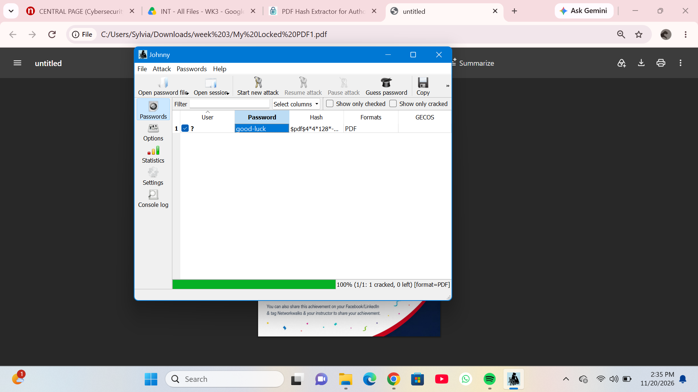
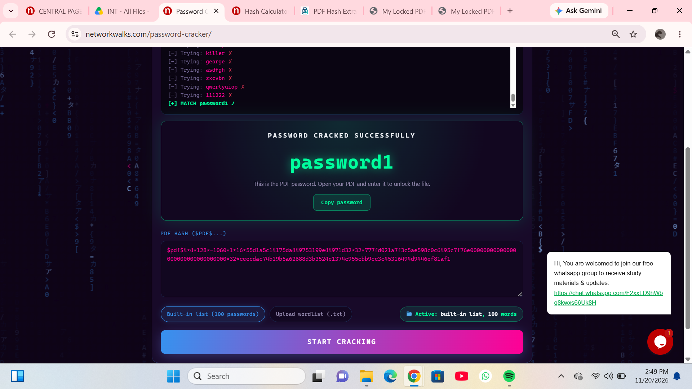

# PASSWORD CRACKING LAB REPORT
### John the Ripper (JTR) & Networkwalks Tools

**W3-PM-FINAL | CYBERSECURITY & ETHICAL HACKING | NETWORKWALKS**

| Field | Detail |
|---|---|
| **Pentester Name** | Ebuwa Sylvia Ehigie |
| **Program/Batch** | B084 – Networkwalks |
| **Date** | November 20, 2026 |
| **Modules Completed** | W3-PM1 (Password Cracking with JTR); W3-PM2 (Password Cracking with NW Tools) |
| **Lab Environment** | Windows Operating System |
| **Tools Used** | John the Ripper (JTR), Networkwalks Online Tools, Notepad |
| **Authorization** | Educational lab and assigned password-protected PDF samples |

---

# 1. Liability Disclaimer

I performed these activities strictly within the assigned educational lab environment using the password-protected PDF samples provided for the practical exercises.

The purpose of these activities was to develop practical cybersecurity knowledge and understand password security vulnerabilities. Password-cracking techniques must never be used to access another person's account, device, or system without proper authorization.

All activities documented in this report were conducted for educational purposes and within the approved scope of the exercises.

# 2. Introduction

This report documents the two compulsory practical modules assigned during Week 3 of the Networkwalks Cybersecurity and Ethical Hacking program.

The practical exercises covered:

- **W3-PM1:** Password Cracking with John the Ripper (JTR).
- **W3-PM2:** Password Cracking with Networkwalks Tools (NW Tools).

Password security is an important part of cybersecurity because passwords protect personal information, applications, and computer systems. Weak or predictable passwords can make unauthorized access easier.

The purpose of these practical exercises was to gain hands-on experience with password-cracking tools, understand how password hashes are used in password auditing, and observe how password-protected files can be tested in an authorized environment.

This report presents the objectives, procedures, observations, results, and supporting screenshots for both practical modules.

# 3. Modules and Tools Used

| Module | Activity | Tool |
|---|---|---|
| W3-PM1 | Password Cracking with John the Ripper | John the Ripper (JTR) |
| W3-PM2 | Password Cracking with Networkwalks Tools | Networkwalks Online Tools |

### Lab Environment Details

- **Operating System:** Windows
- **Virtual Machine:** Not used
- **John the Ripper:** Application installed on Windows
- **Networkwalks Tools:** Online platform
- **Supporting Application:** Notepad for saving the extracted hash
- **Input Files:** Two assigned password-protected PDF documents

# 4. Activities Performed

## 4.1 W3-PM1 – Password Cracking with John the Ripper (JTR)

### Objective

The objective of this practical was to understand how John the Ripper can be used to test and recover passwords from password-protected files in an authorized laboratory environment.

The exercise involved extracting a hash from a locked PDF document, preparing the hash for testing, and using John the Ripper to attempt password recovery.

### Lab Environment and Preparation

- **Operating System:** Windows
- **Tool Used:** John the Ripper (JTR)
- **Input File:** My Locked PDF1
- **Supporting Application:** Notepad
- **Input Type:** Extracted PDF password hash

### Procedure

The following steps were performed during the practical:

1. I started with the assigned password-protected PDF document named **My Locked PDF1**.
2. I used an online hash-extraction service to obtain the hash associated with the PDF file.
3. I copied the extracted hash and pasted it into Notepad for preparation.
4. I opened the John the Ripper application on my Windows computer.
5. I supplied the prepared hash to John the Ripper for password testing.
6. I allowed the application to perform the password-cracking exercise and examined its output.
7. John the Ripper successfully recovered the password.
8. I used the recovered password to open the original PDF document and confirmed that it was correct.

### Results and Observations

The John the Ripper practical was successful. The tool recovered the password associated with the assigned PDF document.

**Recovered Password:** `good-luck`

After obtaining the password, I used it to open **My Locked PDF1** successfully.

This exercise demonstrated how password hashes can be extracted from password-protected PDF files and evaluated using password-auditing tools. It also showed that passwords with predictable patterns may be vulnerable to recovery attempts.

### Screenshot Evidence

**Figure 1: John the Ripper Lab Setup**

*This screenshot shows the John the Ripper practical setup and preparation.*

**Figure 2: John the Ripper Results**

*This screenshot shows the successful password recovery using John the Ripper.*

---

## 4.2 W3-PM2 – Password Cracking with Networkwalks Tools (NW Tools)

### Objective

The objective of this practical was to gain hands-on experience using the Networkwalks online password-cracking tools to test a password-protected PDF document.

The exercise focused on using the assigned online platform, supplying the required input, and observing the password recovery result.

### Lab Environment and Preparation

- **Operating System:** Windows
- **Tool Used:** Networkwalks Online Tools
- **Input File:** My Locked PDF1 (for NW Tools Lab WK3-PM2)
- **Input Type:** Password-protected PDF document

### Procedure

The following steps were performed during the practical:

1. I identified the second assigned password-protected PDF document named **My Locked PDF1 (for NW Tools Lab WK3-PM2)**.
2. I accessed the Networkwalks online tools platform through my web browser.
3. I selected the assigned password-cracking functionality available on the platform.
4. I supplied the second PDF document as the input for the exercise.
5. I initiated the password-testing process and waited for the platform to complete the task.
6. I examined the result displayed by the Networkwalks tool.
7. The platform successfully recovered the password.
8. I used the recovered password to open the original PDF document and confirmed that it was correct.

### Results and Observations

The Networkwalks Tools practical was successful. The online tool recovered the password associated with the second assigned PDF document.

**Recovered Password:** `password1`

I used the recovered password to open **My Locked PDF1 (for NW Tools Lab WK3-PM2)** successfully.

This exercise demonstrated how online password-auditing tools can be used to evaluate password-protected files. It also provided practical experience with a different password-testing environment.

### Screenshot Evidence

**Figure 3: Networkwalks Tools Lab**

*This screenshot shows the Networkwalks online password-cracking practical.*

**Figure 4: Networkwalks Tools Results**

*This screenshot shows the successful password recovery using Networkwalks Tools.*

---

# 5. Comparison and Key Learnings

Both practical exercises focused on password security and demonstrated how different tools can be used to recover passwords from authorized password-protected PDF samples.

John the Ripper was used through an application installed on my Windows computer. The process involved extracting the PDF hash, saving it in Notepad, and supplying it to the application for password testing.

In contrast, Networkwalks Tools was accessed through the Networkwalks online platform. I supplied the second assigned PDF document to the platform and allowed it to perform the password-testing exercise.

Both tools successfully recovered their respective passwords, and I confirmed the results by opening both PDF documents.

### Summary of Results

| Practical | Tool | Input File | Result |
|---|---|---|---|
| W3-PM1 | John the Ripper | My Locked PDF1 | Successful |
| W3-PM2 | Networkwalks Tools | My Locked PDF1 (for NW Tools Lab WK3-PM2) | Successful |

### Key Learnings

1. **Understanding Password Hashes:** I learned that password hashes can be extracted from password-protected files and used in authorized password-auditing exercises.

2. **Using Different Password-Cracking Tools:** I gained practical experience using John the Ripper on Windows and Networkwalks Tools through an online platform.

3. **Importance of Password Strength:** The exercises demonstrated that weak or predictable passwords, such as commonly used password patterns, can be easier to recover.

4. **Practical Cybersecurity Experience:** I learned how to prepare password hashes, work with password-testing tools, interpret their results, and verify recovered passwords.

5. **Importance of Ethical Testing:** I understood that password-cracking tools must only be used within an authorized testing environment.

# 6. Security Considerations and Recommendations

The practical exercises demonstrated why strong password practices are essential for protecting digital information and computer systems.

The following recommendations can help improve password security:

1. **Use Long and Unique Passwords:** Passwords should be sufficiently long and difficult to guess. Avoid predictable words, personal information, and password reuse.

2. **Use a Password Manager:** Password managers help generate and securely store unique passwords for different accounts.

3. **Enable Multi-Factor Authentication (MFA):** MFA provides an additional layer of security by requiring another form of verification during authentication.

4. **Protect Password Hashes:** Organizations should protect stored password databases using appropriately configured, salted password-hashing algorithms.

5. **Monitor Suspicious Activities:** Authentication logs should be reviewed regularly to identify unusual login attempts and potential security threats.

6. **Conduct Authorized Security Testing:** Password-auditing exercises should only be performed on accounts, password samples, and systems for which explicit authorization has been granted.

# 7. Conclusion

The Week 3 practical exercises of the Networkwalks Cybersecurity and Ethical Hacking program provided valuable hands-on experience with two password-cracking tools: John the Ripper and Networkwalks Tools.

In the first practical, I used John the Ripper on my Windows computer to test the hash extracted from the assigned PDF document, **My Locked PDF1**. The tool successfully recovered the password, `good-luck`, which I used to open the document.

In the second practical, I used the Networkwalks online tools platform to test the second assigned PDF document, **My Locked PDF1 (for NW Tools Lab WK3-PM2)**. The platform successfully recovered the password, `password1`, and I confirmed the result by opening the document.

Both exercises were completed successfully and helped me understand how password hashes are used in password auditing, how different tools can be applied to password-testing exercises, and why weak passwords can create security risks.

Overall, the practicals improved my understanding of ethical hacking, password security, and the importance of using cybersecurity tools responsibly. They also reinforced the need to create strong, unique passwords to protect personal and organizational information.

# 8. Evidence Collected

Screenshots from both practical exercises are included in the `screenshots/` folder of this repository as supporting evidence of the activities performed and the successful results obtained.

| Screenshot | Description |
|---|---|
| `jtr-lab.png` | John the Ripper practical setup. |
| `jtr-lab-result.png` | John the Ripper password recovery result. |
| `nw-tools-lab.png` | Networkwalks Tools practical setup. |
| `nw-tools-lab-result.png` | Networkwalks Tools password recovery result. |

The screenshots provide visual evidence of the practical exercises and their outcomes. Sensitive information and unrelated personal credentials should not be exposed in the submitted evidence.

---

## Optional Week 3 Modules

The Week 3 assignment document also identifies the following optional activities, which are separate from the two compulsory modules covered in this report:

- **W3-OPTIONAL1:** AI – JTR Password Cracking Lab with Claude & Hexstrike MCP v1 (requires MCP Server setup with Claude Desktop first).
- **W3-OPTIONAL2:** Mediroza Hospital patient portal hacking.

These optional activities are not included in the compulsory practical results documented above.

---

**End of Report**
